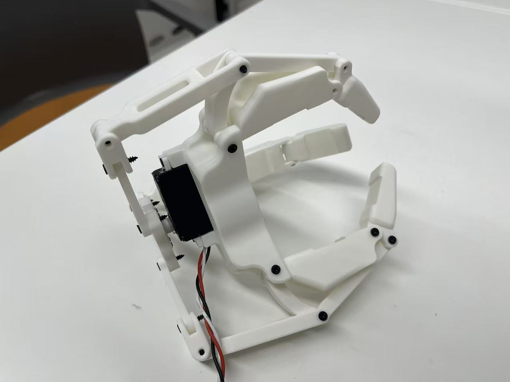

# Single-Servo Three-Finger Underactuated Robotic Hand

A fully 3D-printable, low-cost dexterous gripper driven by **a single bus servo**. Three fingers, six joints, one motor — the underactuated linkage handles the rest, passively conforming to whatever object it grasps.



---

## Highlights

- **One actuator, three fingers.** A central rotary disc splits a single servo's rotation into three symmetric 120°-spaced linkages, so all three fingers open and close together.
- **Passive self-adaptation.** Each finger is a two-segment underactuated linkage. When one segment is blocked by the object, the servo's remaining travel forces the next segment to keep curling — the hand envelops irregular shapes with no sensors and no per-finger control.
- **No force sensor required.** Grasp completion is detected by *stall detection* on the servo's position feedback, then the position is locked to hold the object and protect the motor from overheating.
- **Fully 3D-printed.** Rigid PLA skeleton + soft TPU fingertip pads. No machining needed.
- **Software-selectable grip force.** Four tunable profiles (ULTRA / SOFT / NORMAL / FIRM) cover everything from a toy tomato to an aluminum can.

## Specifications (typical)

| Parameter | Value |
|---|---|
| Fingers | 3 (×2 phalanges each) |
| Actuators | 1 bus servo |
| Degrees of freedom | 6 (driven by 1 motor) |
| Max opening width | ~90–110 mm |
| Graspable object size | ~50–150 mm |
| Object weight (typical) | up to a few hundred grams |
| Structure material | PLA |
| Fingertip pads | TPU 95A |
| Total mass (with servo) | ~220–280 g |
| Control interface | Serial (USB-to-bus adapter) |

> Values are estimates and depend on your servo torque, print quality, and assembly. Calibrate before use.

## Repository structure

```
.
├── README.md                  ← you are here
├── src/                       ← Python control code
│   ├── single_gripper.py      ← core controller class (calibration, grasp logic)
│   ├── teleop_gripper.py      ← keyboard teleoperation (4 grip modes)
│   └── servo_host.py          ← low-level serial driver (PLACEHOLDER — see note)
├── docs/
│   ├── design_principles.md   ← how and why it works
│   ├── assembly.md            ← build & wiring guide
│   └── demo_playbook.md       ← step-by-step demo walkthrough
├── hardware/
│   └── BOM.md                 ← bill of materials & print settings
└── media/
    └── hand_assembled.jpg
```

## Quick start

```bash
# 1. install dependency
pip install pyserial numpy

# 2. find your serial port
#    Windows: Device Manager → Ports (COM & LPT) → USB-SERIAL CH340 (COMx)
#    Linux:   ls /dev/ttyUSB*

# 3. calibrate the open/closed limits (do this once per build)
python src/single_gripper.py --port COM3 calib

# 4. run keyboard teleoperation
python src/teleop_gripper.py --port COM3
```

Then press `[SPACE]` to grasp, `[R]` to release, `[M]` to cycle grip modes. Full key map in [docs/demo_playbook.md](docs/demo_playbook.md).

## How it works (30-second version)

```
Servo rotation → servo horn → rotary disc → 3 linkages → 3 fingers close together
```

The servo angle maps one-to-one to how open the hand is, so control is a single-variable problem. During a grasp the software ramps the servo toward "closed" while polling its position; when the angle stops changing before reaching the target, the object has been contacted — the controller locks the current position to hold the grip. Read the full explanation in [docs/design_principles.md](docs/design_principles.md).

> ⚠️ **Note on `servo_host.py`:** this repo ships a documented *placeholder/reference* driver describing the expected interface (`read_joints()`, `move_to_joints()`). Replace it with the driver for your specific bus-servo hardware, or adapt the placeholder to your serial protocol. See comments in the file.

## Roadmap

- [ ] Add a camera for visual object detection and auto-aim
- [ ] Add current-sensing for true force feedback
- [ ] ROS 2 node wrapper
- [ ] Teach-and-replay trajectory recording

## License

Released under the [MIT License](LICENSE). You are free to build, modify, and share.

## Acknowledgements

Hardware platform based on bus-servo + USB-to-bus adapter components. Mechanism is a single-actuator underactuated design intended for education and research.
